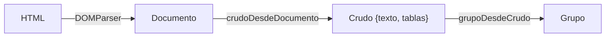
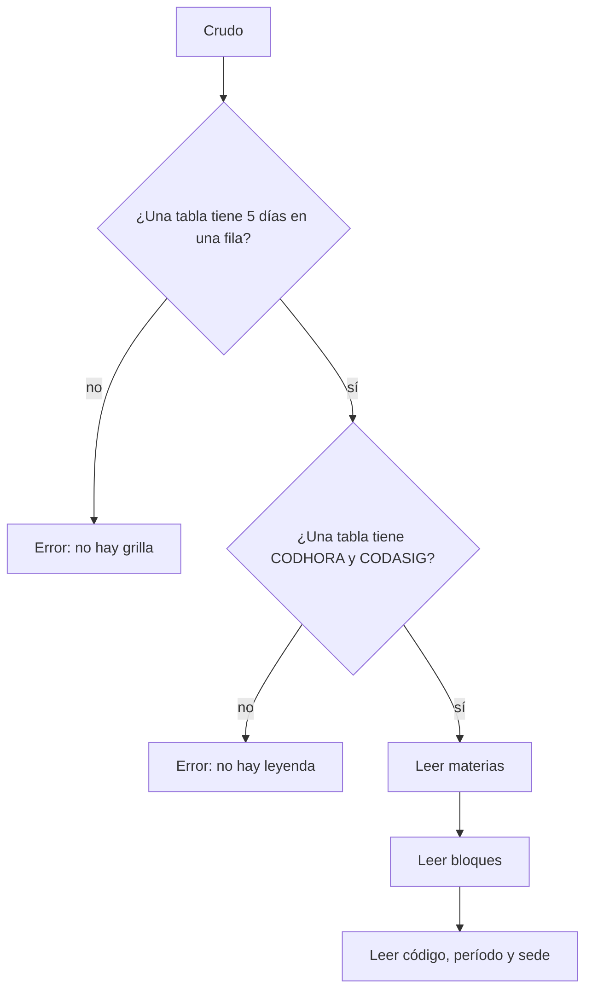

# 1. Entrada

Código: `js/entrada.js`. Las tres entradas dan un `Grupo`.

| Entrada | Función |
|---|---|
| HTML de *Horario del Grupo* | `grupoDesdeHtml(html)` |
| JSON de grupos | `gruposDesdeJson(datos)` |
| Formulario a mano | `grupoManual(datos, grupos)` |

El HTML pasa por dos pasos. El segundo paso no usa el navegador. Así las pruebas lo pueden usar solo.



## 1.1 La página del portal

La página tiene estas partes, en este orden:

1. Botones con los códigos de **otros** grupos.
2. Rótulos: sede, `GRUPO: 1LB421`, carrera, nivel y turno.
3. La grilla: columnas `HORA, LUNES … DOMINGO`. Cada celda tiene un `<p>` por clase.
4. La leyenda: columnas `ASIGNATURA, CODASIG, CODHORA, PROFESOR, EMAIL, SEDE *`.

El motor busca las tablas por su contenido. No usa los `id`, porque el texto pegado no los tiene.

## 1.2 Paso 1: HTML a Crudo

```ts
type Crudo = { texto: string; tablas: string[][][] };
```

- `texto`: todos los textos del `<body>`, unidos con un espacio.
- `tablas`: cada `<table>` como una matriz de textos. Una celda con `rowspan` o `colspan` ocupa todas sus posiciones.

Para leer el texto de una celda:

1. Cambia cada correo con `data-cfemail` por el correo real.
2. Cambia cada `<br>` por un salto de línea.
3. Pon una línea `¶` antes de cada `<p>`, menos el primero. Esta línea separa las clases.
4. Limpia los espacios de cada línea.
5. Quita las líneas vacías.

**Correo.** El valor de `data-cfemail` está en hexadecimal. El primer byte es la clave. Cada byte siguiente da una letra:

$$
c_i = b_i \oplus b_0 \qquad (i \ge 1)
$$

## 1.3 Paso 2: Crudo a Grupo



### Funciones de texto

| Función | Resultado |
|---|---|
| `limpio` | Un solo espacio entre palabras, sin espacios al inicio ni al final. |
| `normalizar` | Sin tildes, en mayúsculas y limpio. |
| `clave` | Normalizado, solo con `A-Z` y `0-9`. |
| `diaIndex` | `LUNES` da 0 y `DOMINGO` da 6. Otro texto da −1. |

### Materias

1. Busca la cabecera de la leyenda: es la primera fila con `CODHORA`.
2. Busca cada columna por su nombre.
3. Lee solo las filas que tienen un número en `CODHORA`.

| Campo | Valor |
|---|---|
| `codasig` | Texto. Conserva los ceros: `"0599"`. |
| `codhora` | Número: `"0181"` da 181. |
| `asignatura`, `profesor` | Texto limpio. |
| `email` | Texto sin espacios. |
| `bloques` | Lista vacía. La grilla la llena. |

### Bloques

1. Busca la cabecera de la grilla: es la primera fila con 5 días o más.
2. Lee la hora de cada fila con `rangoDesdeTexto` ([Hora de una fila](02-tiempo.md#22-hora-de-una-fila)). El resultado es `[inicio, fin]`.
3. Ignora las filas sin hora.
4. Ordena las filas por inicio.
5. Divide cada celda en clases con `leerCeldas`:
   - Corta en cada línea `¶`.
   - Si no hay `¶`, corta después de cada línea `aula …`. Esto pasa con el texto pegado.
6. Lee cada clase con `leerCelda`:

| Parte | Regla |
|---|---|
| `aula` | El texto después de `aula` o `AULA:`, hasta el fin de la línea. |
| `tipo` | `(C+L)` da `CL`. `(L )` da `L`. Otro texto da `C`. |
| `sub` | Si el tipo es `C` y el nombre termina en `(A )` … `(F )`, la letra. |
| `nombre` | El texto antes de `aula`, sin el último paréntesis. |

| Celda | Resultado |
|---|---|
| `ESTRUCT.DATOS I(L )` / `aula 4fis` | `ESTRUCT.DATOS I`, `L`, `4fis` |
| `MÉTODOS NUMÉRIC(B )` / `aula 1-311` | `MÉTODOS NUMÉRIC`, `C`, `1-311`, sub `B` |

7. Busca la materia de cada clase por su `clave`:
   1. Busca una clave igual.
   2. Si no hay, busca una clave que empiece con la otra.
   3. Si no hay, da un error.
8. Une las filas seguidas de una misma clase en un bloque. Las filas son de la misma clase si tienen el mismo día, C.HORA, tipo, aula y subgrupo. La fila nueva debe empezar 10 minutos o menos después del fin del bloque:

$$
0 \le \text{inicio}_{\text{fila}} - \text{fin}_{\text{bloque}} \le 10 \;\Rightarrow\; \text{fin}_{\text{bloque}} \leftarrow \max(\text{fin}_{\text{bloque}},\ \text{fin}_{\text{fila}})
$$

9. Ordena los bloques de cada materia por día y por inicio.

No uses el color de fondo para unir la grilla con la leyenda. El portal no siempre da el mismo color en las dos tablas.

### Código, período y sede

| Dato | Regla | Texto |
|---|---|---|
| `grupo` | 1. `GRUPO:\s*([A-Z0-9]{1,4}\d{3,4})`<br>2. `[A-Z]?\d{1,2}[A-Z]{1,4}\d{3,4}` o `[A-Z]{3}\d{3}`<br>3. `SIN-CODIGO-` y el C.HORA menor | Sin normalizar |
| `periodo` | `II-2026`. Si no está, `PERIODO: II` y `AÑO: 2026`. | Normalizado |
| `sede` | Después de `SEDE` o `CENTRO REGIONAL DE`, o antes de `- 4GS111` | Normalizado |

- Las sedes son `BOCAS DEL TORO`, `PANAMA OESTE`, `PANAMA`, `AZUERO`, `CHIRIQUI`, `COCLE`, `COLON` y `VERAGUAS`. `PANAMA OESTE` está antes que `PANAMA`.
- El motor busca `GRUPO:` primero, porque los botones de otros grupos están antes.
- El motor no cambia las mayúsculas del código. `6IN141` y `6in141` son dos grupos.

## 1.4 JSON

La entrada puede ser un grupo o una lista de grupos. Cada grupo necesita `grupo` (texto) y `materias` (lista). Después, el motor cambia el formato viejo de los bloques ([Formato viejo](03-modelo.md#32-formato-viejo)).

## 1.5 Materia a mano

1. Si el nombre está vacío, da un error.
2. Si no hay bloques, da un error.
3. Si dos bloques del mismo día se pisan, da un error.
4. Para `codasig`, usa el de una materia con el mismo nombre. Si no hay, usa `M-` y la clave.
5. Para `codhora`, usa el número negativo siguiente al menor que existe. Así nunca es igual a un C.HORA del portal.

El formulario usa la rejilla de 50 minutos y guarda los bloques en minutos.

## 1.6 Errores

| Mensaje | Causa |
|---|---|
| No encontré la tabla del horario | La página no tiene grilla. |
| No encontré la tabla de asignaturas | La página no tiene leyenda. |
| La tabla de asignaturas está vacía | Ninguna fila tiene un número en `CODHORA`. |
| "X" no aparece en la tabla de asignaturas | Una clase no tiene materia. |
| El JSON no tiene el formato de grupo esperado | El JSON no es válido. |
