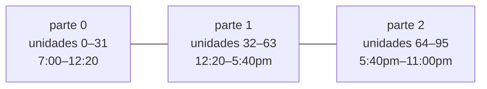

# 2. Tiempo

Código: `js/periodos.js` y `js/bits.js`.

## 2.1 Rejillas

El motor guarda cada hora en minutos desde las 0:00. La UTP usa dos rejillas:

| Rejilla | Inicio | Fin | Ejemplo |
|---|---|---|---|
| A (períodos) | $420 + 50k$ | inicio + 45 | 7:00–7:45, 7:50–8:35 … 10:00–10:45pm |
| H (horas) | $60h$ | inicio + 55 | 6:00–6:55pm, 7:00–7:55pm |

La mayoría de los grupos usa la rejilla A. Algunos grupos de posgrado usan la rejilla H.

$$
\text{inicioMin}(k) = 420 + 50k \qquad \text{finMin}(k, n) = \text{inicioMin}(k + n - 1) + 45
$$

El motor usa `inicioMin` y `finMin` solo en el formulario a mano, en el formato viejo y en los nombres de los turnos.

## 2.2 Hora de una fila

`minDesdeTexto(t)` lee la primera hora `H:MM` del texto. Si el texto tiene `A.M.` o `P.M.`, aplica esta regla:

$$
h' = \begin{cases} h + 12 & \text{P.M. y } h < 12 \\ 0 & \text{A.M. y } h = 12 \\ h & \text{otro caso} \end{cases}
\qquad \text{minutos} = 60h' + m
$$

Si el texto no tiene hora, el resultado es `NaN`.

`rangoDesdeTexto(t)` da `[inicio, fin]` o `null`:

1. Lee el inicio con `minDesdeTexto(t)`. El `A.M.`/`P.M.` del final vale para las dos horas.
2. Si no hay inicio, da `null`.
3. Lee el fin en el texto después del primer `-` o `–`.
4. Si no hay fin, usa inicio + 45. Esto pasa con el PDF: `05:50:00 PM`.
5. Si el inicio es mayor que el fin y es 720 o más, resta 720 al inicio.
6. Si el inicio es menor que el fin, da `[inicio, fin]`. Si no, da `null`.

| Etiqueta | Resultado |
|---|---|
| `7:00-7:45A.M.` | `[420, 465]` |
| `12:50-1:35P.M.` | `[770, 815]` |
| `6:00-6:55P.M.` | `[1080, 1135]` |
| `10:00-10:45P.M.` | `[1320, 1365]` |
| `11:30-12:15P.M.` | `[690, 735]` |
| `05:50:00 PM` | `[1070, 1115]` |
| `HORA` | `null` |

## 2.3 Turnos

El inicio de un bloque da su turno:

$$
\text{turno}(t) = \begin{cases}
\text{mañana} & t < 770 \quad (\text{antes de } 12{:}50) \\
\text{tarde} & 770 \le t < 1020 \quad (\text{antes de } 5{:}00\text{pm}) \\
\text{noche} & t \ge 1020
\end{cases}
$$

Una sección cumple un turno si todos sus bloques empiezan en ese turno.

## 2.4 Unidades de 10 minutos

El motor divide cada día en 96 unidades de 10 minutos, de 7:00 a 23:00. Guarda las unidades en 3 números de 32 bits por día. Una sección tiene $7 \times 3 = 21$ números. El número del día $d$ y la parte $w$ está en la posición $3d + w$.



Para marcar un bloque `[inicio, fin)` del día $d$ (`marcar`):

$$
u(t) = \min\!\Big(96,\ \max\!\big(0,\ \tfrac{t - 420}{10}\big)\Big),\qquad
a = \lfloor u(\text{inicio}) \rfloor,\qquad
b = \lceil u(\text{fin}) \rceil - 1
$$

1. Marca las unidades $a$ a $b$.
2. La unidad $x$ es el bit $x \bmod 32$ de la parte $\lfloor x/32 \rfloor$.

Para marcar los bits $lo$ a $hi$ de una parte, usa esta máscara de 32 bits:

$$
\text{tramo}(lo, hi) = (\texttt{-1} \ggg (31 - hi)) \;\&\; (\texttt{-1} \ll lo)
$$

Las dos rejillas no dan choques falsos. Todos los inicios son múltiplos de 10, y el motor redondea el fin hacia arriba:

| Clase | Última unidad | La clase siguiente empieza en |
|---|---|---|
| 7:00–7:45 | 4 (7:40–7:50) | unidad 5 (7:50) |
| 6:00–6:55pm | 71 (6:50–7:00) | unidad 72 (7:00pm) |

Un choque real entre las dos rejillas sí aparece. Por ejemplo, 6:00–6:55pm (unidades 66–71) choca con 5:50–6:35pm (65–69).

Límites: una clase antes de las 7:00 empieza en la unidad 0. El motor no marca el tiempo después de las 23:00. Los datos reales van de 7:00 a 10:45pm.

## 2.5 Huecos

Una unidad libre está entre la primera y la última unidad ocupada del mismo día. Un hueco es una serie de unidades libres seguidas.

`huecosDia(partes, i0, salida)` usa las 3 partes del día:

$$
p = \text{primera unidad ocupada},\quad q = \text{última unidad ocupada},\quad
\text{libre}_w = \text{tramo}_w(p, q) \;\&\; \lnot\,\text{parte}_w
$$

1. Escribe las 3 máscaras $\text{libre}_w$ en `salida`.
2. Da la cantidad de unidades libres: $\sum_w \operatorname{popcount}(\text{libre}_w)$.

`tramosLibres(libre)` da la cantidad de huecos. Cuenta cada unidad libre cuya unidad anterior está ocupada:

$$
\text{huecos} = \sum_{w=0}^{2} \operatorname{popcount}\big(\text{libre}_w \;\&\; \lnot((\text{libre}_w \ll 1) \mid c_w)\big),\qquad c_0 = 0,\quad c_{w+1} = \text{libre}_w \ggg 31
$$

| Día | Unidades libres | Huecos |
|---|---|---|
| 7:00–7:45 y 7:50–8:35 | 0 | 0 |
| 7:00–7:45 y 8:40–9:25 | 5 | 1 |
| 7:00–7:45 y 10:00–10:45pm | 85 | 1 |
| 7:00–7:45, 8:40–9:25 y 10:00–10:45pm | 80 | 2 |

La penalidad usa las unidades libres. La pantalla muestra los huecos.

`popcount` cuenta los bits de un número de 32 bits:

```
x = x - ((x >>> 1) & 0x55555555)
x = (x & 0x33333333) + ((x >>> 2) & 0x33333333)
return imul((x + (x >>> 4)) & 0x0f0f0f0f, 0x01010101) >>> 24
```
