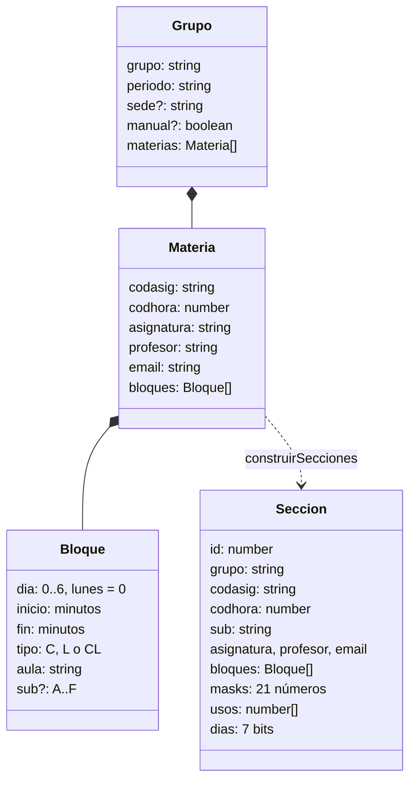
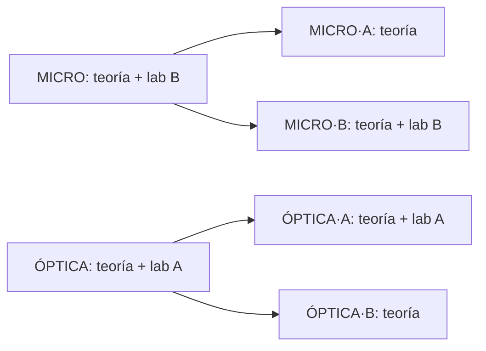

# 3. Modelo

Código: `js/modelo.js`.

## 3.1 Tipos



| Campo de `Seccion` | Valor |
|---|---|
| `masks` | Las 21 partes de unidades ocupadas ([Unidades de 10 minutos](02-tiempo.md#24-unidades-de-10-minutos)). |
| `usos` | Pares `[posición, parte]`, solo de las partes con algún bit. |
| `dias` | El bit $d$ indica clase el día $d$. El lunes es 0. |
| `sub` | Letra del subgrupo, o `""`. |
| `id` | Posición en la lista de secciones. |

Ejemplo de grupo en JSON:

```json
{"grupo": "1GS232", "periodo": "II-2026", "materias": [
  {"codasig": "8408", "codhora": 2679, "asignatura": "DES. SOFT. VIII",
   "profesor": "CALDERON, TOMAS", "email": "tomas.calderon@utp.ac.pa",
   "bloques": [[1, 1070, 1165, "C", "3-301"], [3, 1070, 1165, "L", "3-403"]]}
]}
```

## 3.2 Formato viejo

Antes, un bloque era `[día, k, n, tipo, aula]` en períodos de la rejilla A. `migrarGrupos` lo cambia a minutos. Un inicio en minutos es 420 o más. Un $k$ es menor que 420.

$$
[d, k, n, \ldots] \;\to\; [d,\ 420 + 50k,\ 420 + 50(k + n - 1) + 45,\ \ldots] \qquad \text{si } k < 420
$$

El motor aplica esta regla al leer `localStorage` y al leer un JSON.

## 3.3 Subgrupos

Un subgrupo es parte del **grupo completo**. Un estudiante tiene la misma letra en todas las materias del grupo. Ejemplo del grupo `1TB221`, el lunes a las 5:00pm: el subgrupo B está en `MICROCONTROLADO`, y el subgrupo A está en `ÓPTICA BIOMÉD.`

$L_g$ es el conjunto de letras de todos los bloques del grupo $g$. Cada materia $m$ de $g$ da estas secciones:

$$
\text{secciones}(m) = \begin{cases}
\{\ \text{teoría}(m) \cup \text{bloques}_x(m) : x \in L_g\ \} & \text{si } m \text{ tiene bloques con letra} \\
\{\ \text{bloques}(m),\ \text{sub} = \texttt{""}\ \} & \text{otro caso}
\end{cases}
$$

$\text{teoría}(m)$ son los bloques sin letra. Si una materia no tiene laboratorio para una letra, la sección de esa letra tiene solo la teoría.



## 3.4 Construir las secciones

`construirSecciones(grupos)`:

1. Para cada grupo, lista sus letras en orden.
2. Para cada materia, haz una sección por letra, o una sección sin letra ([Subgrupos](#33-subgrupos)).
3. Para cada sección:
   1. Marca sus bloques en `masks`.
   2. Marca sus días en `dias`.
   3. Ordena sus bloques por día y por inicio.
   4. Haz `usos` con las partes que tienen algún bit.
4. Guarda cada sección con la llave `codhora|sub`. Si la llave se repite, queda la última.
5. Pon `id` igual a la posición de cada sección en la lista.

## 3.5 Choques

Dos secciones son del **mismo grupo** si las dos son del portal ($\text{codhora} > 0$) y tienen el mismo código de grupo.

$$
\text{chocan}(a, b) = \begin{cases}
a.\text{sub} \ne \texttt{""} \;\wedge\; b.\text{sub} \ne \texttt{""} \;\wedge\; a.\text{sub} \ne b.\text{sub} & \text{mismo grupo} \\[4pt]
\displaystyle\bigvee_{i=0}^{20} \big(a.\text{masks}[i] \;\&\; b.\text{masks}[i] \ne 0\big) & \text{otro caso}
\end{cases}
$$

En un mismo grupo, el horario oficial manda:

- Dos letras distintas siempre chocan. Un estudiante no puede estar en A y en B.
- Lo demás no choca, aunque las horas se pisen. Ejemplo: el grupo `2GP211` tiene dos módulos de maestría a la misma hora y en la misma aula.

Las materias a mano ($\text{codhora} < 0$) siempre chocan por horas.

## 3.6 Lista de materias

`listarMaterias(secciones)` da una entrada por C.ASIG, en orden alfabético. El campo `secciones` cuenta los C.HORA distintos. Los subgrupos de un C.HORA cuentan una vez.
