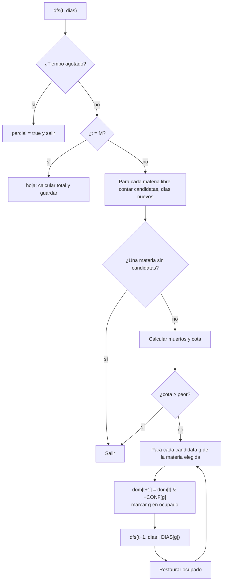

# 5. Solver

Código: `js/solver.js`.

El solver busca las $K$ opciones de menor penalidad. Hace una búsqueda en profundidad: elige una sección por materia, una materia a la vez. Antes de bajar un nivel, calcula una cota: la penalidad mínima posible desde ese punto. Si la cota no mejora la peor opción guardada, el solver deja esa rama.

## 5.1 Entrada y salida

```ts
resolver(secciones, requeridas, prefs = {}, K = 50, msMax = 1500): Resultado
```

| `estado` | Cuándo | Datos |
|---|---|---|
| `FALTAN` | Una materia no tiene candidatas. | `faltan`: los C.ASIG sin candidatas |
| `SIN_SOLUCION` | No hay ninguna opción. | `choques`: pares de materias que siempre chocan |
| `OK` | Hay opciones. | `opciones` y `parcial` |

Cada opción tiene:

- `secciones`, en orden alfabético de asignatura.
- `penalidad`.
- `detalle`: `{dias, huecos}`. `huecos` es la cantidad de huecos, no de unidades.

Las opciones están en orden de penalidad, de menor a mayor. Si dos opciones tienen la misma penalidad, queda primero la que el solver encontró primero.

## 5.2 Tablas

El solver numera todas las candidatas: primero las de la materia 0, después las de la materia 1, y así. El número global de una candidata es $g$.

| Tabla | Contenido |
|---|---|
| `base[j]` | Número global de la primera candidata de la materia $j$. |
| `woff[j]` | Primera palabra de la materia $j$ en un conjunto de bits. La materia $j$ usa $\lceil n_j / 32 \rceil$ palabras. $TW$ es el total. |
| `DIAS[g]` | Días con clase (7 bits). |
| `USO_I`, `USO_M`, `UOFF` | Las partes ocupadas de cada candidata: posición y máscara. |
| `CONF[g]` | Conjunto de bits ($TW$ palabras): las candidatas de **otras** materias que chocan con $g$. |
| `CELDA[u]` | Conjunto de bits ($TW$ palabras): las candidatas que ocupan la unidad $u$. $u = 32 \cdot \text{posición} + \text{bit}$. |

`CONF` usa `chocan` ([Choques](03-modelo.md#34-choques)). El solver lo calcula una vez para cada par de candidatas de materias distintas.

## 5.3 Estado de la búsqueda

| Variable | Contenido |
|---|---|
| `dom[t]` | Candidatas que todavía caben, en el nivel $t$. El nivel $t$ tiene $t$ materias elegidas. |
| `asignada[j]` | 1 si la materia $j$ ya tiene sección. |
| `ocupado` | Las 35 partes ocupadas por las secciones elegidas. |
| `previo` | El valor de cada parte antes de agregar una sección. |
| `muertos[t]` | Unidades libres que ninguna candidata puede ocupar, en el nivel $t$. |
| `testigo[u]` | La última palabra de `CELDA[u]` que tenía una candidata. Acelera la búsqueda de muertos. |
| `mejores` | Las mejores opciones, en orden, con un máximo de $K$. |
| `peor` | La penalidad de la opción $K$. Es $\infty$ mientras haya menos de $K$ opciones. |

## 5.4 Algoritmo



Pasos de `dfs(t, dias)`:

1. Cada 1024 nodos, revisa el tiempo. Si pasó `msMax`, pon `parcial = true` y sal.
2. Si $t = M$, llama a `hoja` y sal.
3. Para cada materia $j$ libre:
   1. Cuenta sus candidatas en `dom[t]`. Si no hay, sal.
   2. Si $w_d > 0$, calcula los días nuevos mínimos de sus candidatas: $\min_g \operatorname{popcount}(\text{DIAS}[g] \;\&\; \lnot\,\text{dias})$.
4. Elige la materia con menos candidatas. Si hay empate, elige la primera.
5. Calcula los muertos ([Unidades muertas](#55-unidades-muertas)).
6. Calcula la cota:

$$
\text{cota} = w_d \cdot \max\!\big(0,\ |\text{dias}| + \max_j \text{díasNuevos}_j - 1\big) \;+\; 1 \cdot \text{muertos}
$$

   $w_d$ es `pesoDias(prefs)` ([Penalidad](04-preferencias.md#44-penalidad)). Si $w_d = 0$, el solver no calcula los días nuevos.
7. Si $\text{cota} \ge \text{peor}$, sal.
8. Para cada candidata $g$ de la materia elegida:
   1. Si $\text{cota} \ge \text{peor}$, para. `peor` baja cada vez que `hoja` guarda una opción.
   2. Calcula `dom[t+1] = dom[t] & ~CONF[g]`. Vacía las palabras de la materia elegida.
   3. Guarda cada parte en `previo` y marca las partes de $g$ en `ocupado`.
   4. Llama a `dfs(t + 1, dias | DIAS[g])`.
   5. Restaura `ocupado` desde `previo`, en orden inverso.
   6. Si `parcial` es true, para.

Restaura `ocupado` desde `previo`, no con `&= ~máscara`. Dos secciones del mismo grupo pueden ocupar la misma unidad. Si quitas los bits de una, también borras los de la otra.

## 5.5 Unidades muertas

Una unidad libre está muerta si ninguna candidata de `dom[t]` la ocupa. Una unidad muerta queda libre en toda la rama, por eso la cota la cuenta.

Para cada día y cada parte:

1. Calcula las unidades libres con `huecosDia(ocupado)`.
2. Empieza con los muertos del nivel anterior. Siguen muertos, porque `dom` solo pierde candidatas.
3. Para cada unidad libre $u$ que todavía no está muerta:
   1. Revisa la palabra `testigo[u]`. Si `dom[t] & CELDA[u]` tiene un bit en esa palabra, la unidad no está muerta.
   2. Si no, revisa todas las palabras. Si encuentras una con un bit, guárdala en `testigo[u]`.
   3. Si ninguna palabra tiene un bit, marca $u$ como muerta.

## 5.6 Hoja

`hoja(dias)`:

$$
\text{total} = w_d \cdot \max(0,\ |\text{dias}| - 1) + 1 \cdot U
$$

$U$ es la cantidad de unidades libres de `ocupado`. La cota y la hoja usan `costo` ([Penalidad](04-preferencias.md#44-penalidad)).

1. Si $\text{total} \ge \text{peor}$, sal.
2. Inserta la opción en `mejores`, después de las que tienen la misma penalidad.
3. Si `mejores` tiene más de $K$ opciones, quita la última.
4. Si `mejores` tiene $K$ opciones, pon `peor` igual a la penalidad de la última.

## 5.7 Por qué la cota es válida

Ningún término de la cota baja cuando el solver agrega secciones:

- Los días con clase solo suben. Cada materia libre agrega por lo menos sus días nuevos mínimos.
- Una unidad muerta queda libre y entre clases hasta el final.

Por eso el resultado es exacto si el tiempo no se acaba.

## 5.8 Pares que siempre chocan

Si no hay opciones, `paresImposibles` da pares de materias $(i, j)$, con $i < j$. En cada par, **cada** candidata de $i$ choca con **cada** candidata de $j$. La pantalla muestra cada par como "X y Y chocan siempre".

## 5.9 Plan B

`reemplazos(secciones, opción, prefs)` da, para cada sección $s$ de la opción, otras secciones que la pueden cambiar sin mover las demás. La llave del mapa es `s.codhora`.

1. `resto` = las otras secciones de la opción.
2. Busca las secciones $x$ que cumplen todo esto:
   - tienen el mismo C.ASIG que $s$;
   - tienen otro C.HORA;
   - no están descartadas con `prefs` sin `fijas`;
   - no chocan con ninguna sección de `resto`.
3. Calcula `penalidad(resto + x)`.
4. Ordena por esa penalidad, de menor a mayor.
5. Deja solo la primera de cada C.HORA. Los subgrupos de un C.HORA son una sola matrícula.

## 5.10 Constantes

| Constante | Valor |
|---|---|
| `K_POR_DEFECTO` | 50 |
| `MS_MAX` | 1500 ms |
| Revisión del tiempo | cada 1024 nodos |
