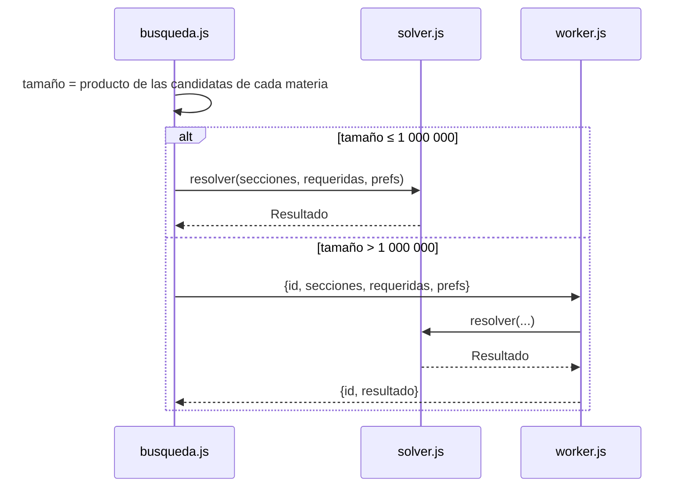

# 6. Integración

Código: `js/estado.js`, `js/busqueda.js` y `js/worker.js`.

## 6.1 Estado guardado

La app guarda el estado en `localStorage`, con la llave `horautp:v1`.

```ts
type Estado = {
  grupos: Grupo[]; // grupos cargados, del portal y a mano
  requeridas: string[]; // C.ASIG de las materias a inscribir
  prefs: Prefs; // preferencias (04-preferencias.md)
};
```

Al leer el estado, si el valor no es válido, la app usa un estado vacío. La app no convierte formatos viejos.

Al agregar un grupo del portal, la app quita el grupo que tiene el mismo código. Las materias del grupo nuevo quedan como requeridas.

## 6.2 Búsqueda



- La app compara el `id` de la respuesta con el último pedido. Si no es igual, ignora la respuesta.
- Si el Worker falla, la app llama a `resolver` en el hilo principal.
- Un pedido nuevo detiene el Worker anterior.
- El Worker recibe una copia de las secciones. Por eso `chocan` usa los campos `grupo`, `sub` y `codhora`, y no la identidad del objeto.

## 6.3 Archivos de datos

| Archivo | Contenido |
|---|---|
| `data/ejemplo.json` | El botón "Ejemplo". 12 grupos de Ing. Electromecánica de Panamá del scrape de noviembre de 2026, como `Grupo[]`. Un estudiante en IV año II semestre (Teoría de Control II, Sistemas de Potencia, Ética Profesional, Ciencias de los Materiales II) con 4 materias atrasadas: Mecánica de Fluidos II, Circuitos Lógicos, Tecnología Eléctrica y Métodos Numéricos. Las atrasadas no son requisito de ninguna materia hasta IV año. Todas las materias tienen 3 a 5 C.HORA en mañana, tarde o noche, y casi todas tienen subgrupos. No hay secciones sin profesor. Hay 4519 opciones de 3 317 760 combinaciones. |
| `tests/datos.csv` | Datos de prueba: 5 grupos. Una fila por bloque: grupo, período, C.ASIG, asignatura, C.HORA, profesor, correo, día, hora de inicio, hora de fin, tipo, aula. |
| `tests/datos.json` | Los mismos datos como `Grupo[]`, con bloques en minutos. |
| `tools/csv-a-json.js` | Convierte el CSV en el JSON: `node tools/csv-a-json.js tests/datos.csv > tests/datos.json`. |
