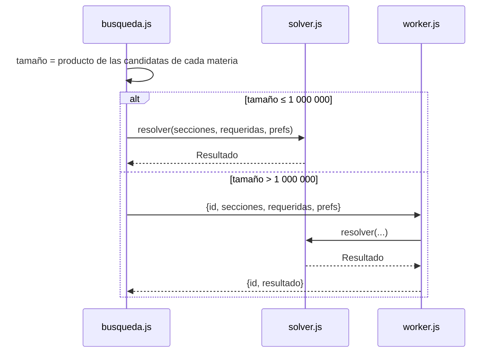

# 6. Integración

Código: `js/estado.js`, `js/busqueda.js`, `js/worker.js` y `js/agentes.js`.

## 6.1 Estado guardado

La app guarda el estado en `localStorage`, con la llave `horautp:v1`.

```ts
type Estado = {
  grupos: Grupo[]; // grupos cargados, del portal y a mano
  requeridas: string[]; // C.ASIG de las materias a inscribir
  prefs: Prefs; // preferencias (04-preferencias.md)
};
```

Al leer el estado:

1. Si el valor no es válido, usa un estado vacío.
2. Cambia los bloques del formato viejo con `migrarGrupos` ([Formato viejo](03-modelo.md#32-formato-viejo)).
3. Cambia las preferencias viejas con `migrar`.

Al agregar un grupo del portal, la app quita el grupo que tiene el mismo código. Las materias del grupo nuevo quedan como requeridas.

## 6.2 Búsqueda



- La app compara el `id` de la respuesta con el último pedido. Si no es igual, ignora la respuesta.
- Si el Worker falla, la app llama a `resolver` en el hilo principal.
- Un pedido nuevo detiene el Worker anterior.
- El Worker recibe una copia de las secciones. Por eso `chocan` usa los campos `grupo`, `sub` y `codhora`, y no la identidad del objeto.

## 6.3 Agentes

La app registra estas herramientas con WebMCP (`document.modelContext`). Si el navegador no tiene WebMCP, están en `window.horautp.<nombre>(entrada)`.

| Herramienta | Entrada | Resultado |
|---|---|---|
| `cargar_horario` | `{html}` o `{json}` | Estado |
| `ver_estado` | — | Grupos, materias con sus secciones y preferencias |
| `elegir_materias` | `{codasig: string[]}` | Estado |
| `ajustar_preferencias` | `turno`, `solo_turno`, `menos_dias`, `profesores_solo`, `profesores_evitados`, `fijas`, `excluidas` | Estado |
| `ver_horarios` | `{cuantas}` (1 a 50) | Opciones con `c_hora`, `subgrupo` y `plan_b` |
| `mostrar_horario` | `{numero}` | Muestra esa opción en la pantalla |

Cada sección del resultado tiene:

- `clases`: un texto por bloque, por ejemplo `Lunes · 5:00pm–8:15pm · subgrupo A · 1-220`.
- `subgrupo`: solo si la sección tiene letra.

## 6.4 Archivos de datos

| Archivo | Contenido |
|---|---|
| `data/horarios.csv` | Una fila por bloque: grupo, período, C.ASIG, asignatura, C.HORA, profesor, correo, día, hora de inicio, hora de fin, tipo, aula. |
| `data/ejemplo.json` | Los mismos datos como `Grupo[]`, con bloques en minutos. |
| `tools/csv-a-json.js` | Convierte el CSV en el JSON: `node tools/csv-a-json.js data/horarios.csv > data/ejemplo.json`. |
