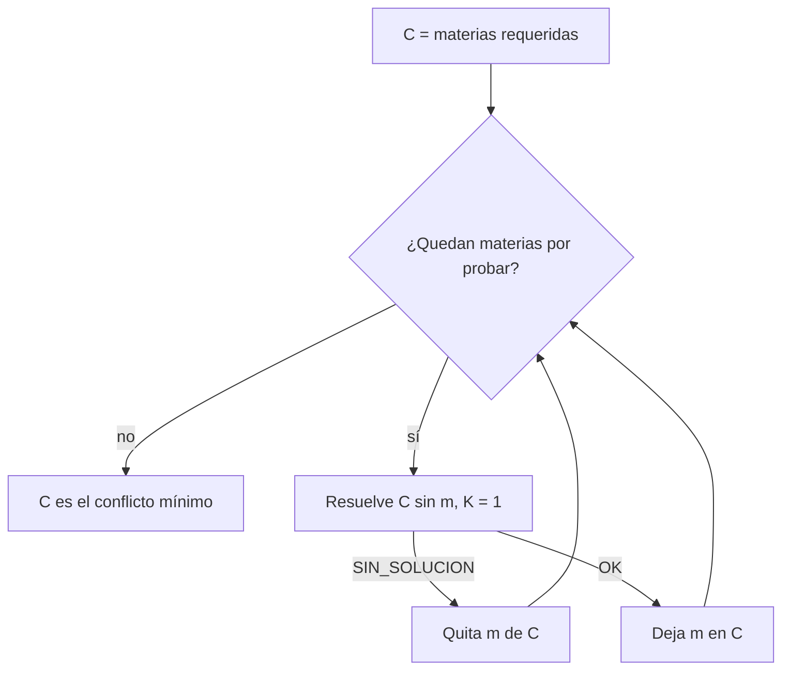

# Ideas

Estas ideas no están en el código. Cada idea empieza con la conclusión.

## Explicar por qué no hay opciones

**Conclusión:** cuando el solver da `SIN_SOLUCION`, la pantalla dice dos cosas:

1. Qué materias no caben juntas.
2. Qué preferencia quitar para tener opciones.

### Problema

- `paresImposibles` solo encuentra pares de materias. En cada par, cada candidata choca con cada candidata de la otra materia.
- Tres materias pueden no tener opción aunque cada par tenga opción. En este caso `choques` está vacío y la pantalla no explica nada.
- La pantalla no dice si la causa es una preferencia. Por ejemplo: un profesor evitado o `soloTurno`.

### Paso 1: conflicto mínimo

Busca el grupo más pequeño de materias sin opción. Usa un filtro por eliminación:

1. Pon todas las materias requeridas en $C$.
2. Para cada materia $m$ de $C$, resuelve $C \setminus \{m\}$ con $K = 1$.
3. Si el resultado es `SIN_SOLUCION`, quita $m$ de $C$.
4. Si el resultado es `OK`, deja $m$ en $C$.
5. Al final, $C$ es el conflicto mínimo.

El paso 1 llama al solver $|C|$ veces como máximo. Con 8 materias son 8 llamadas cortas.

Texto en la pantalla: "SO, DS VIII y Redes no caben juntas".

### Paso 2: preferencia que quitar

Haz este paso solo si el horario tiene opciones sin preferencias.

1. Haz una lista de las preferencias activas: cada profesor evitado, cada entrada de `solo`, `soloTurno` y cada sección excluida.
2. Para cada preferencia, quítala y resuelve con $K = 1$.
3. Si el resultado es `OK`, guarda la preferencia.
4. Muestra las preferencias guardadas.

Texto en la pantalla: "Si permites a ZURITA, hay opciones".

La pantalla no muestra penalidades ni pesos.

### Términos

| Término | Significado |
|---|---|
| Conflicto mínimo (MUS, *Minimal Unsatisfiable Subset*) | Grupo de materias sin opción. Si quitas una materia cualquiera del grupo, hay opción. |
| Filtro por eliminación (*deletion filter*) | El método del paso 1: prueba a quitar las materias una por una. |
| QuickXplain | Método más rápido que el filtro por eliminación. Divide el grupo en mitades. Con 8 materias o menos no hace falta. |
| Relajación | Quitar una preferencia y resolver otra vez. Es el método del paso 2. |

### Cambios

| Archivo | Cambio |
|---|---|
| `js/solver.js` | `conflictoMinimo` y `relajaciones`. Unas 50 líneas. |
| `js/horario.js` | Mensaje con el conflicto mínimo y las preferencias (`sinOpciones`). |
| `js/agentes.js` | El mismo dato en `sin_horario`. |
| `tests/nucleo.test.js` | Caso de tres materias sin opción con cada par con opción. Caso con un profesor evitado. |
