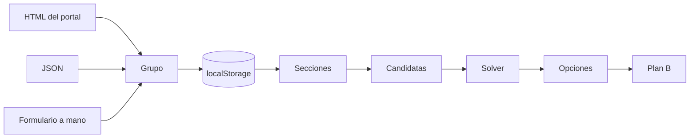

# Motor de horarios

Este documento explica el motor de la app. El motor lee el horario del portal de la UTP y busca las mejores combinaciones de secciones. Con estas reglas puedes hacer otro motor que dé los mismos resultados.

| # | Documento | Código |
|---|---|---|
| 1 | [Entrada](01-entrada.md) | `js/entrada.js` |
| 2 | [Tiempo](02-tiempo.md) | `js/periodos.js`, `js/bits.js` |
| 3 | [Modelo](03-modelo.md) | `js/modelo.js` |
| 4 | [Preferencias](04-preferencias.md) | `js/preferencias.js` |
| 5 | [Solver](05-solver.md) | `js/solver.js` |
| 6 | [Integración](06-integracion.md) | `js/estado.js`, `js/busqueda.js`, `js/worker.js` |
| 7 | [Pruebas](07-pruebas.md) | `tests/` |
| — | [Ideas](IDEAS.md) | — |

## Recorrido

## Términos

Estos documentos usan cada término con un solo significado.

| Término | Significado |
|---|---|
| Grupo | Código del portal, por ejemplo `1GS232`. Un grupo tiene un horario fijo. |
| C.ASIG (`codasig`) | Código de la asignatura. Varios grupos tienen la misma asignatura. |
| C.HORA (`codhora`) | Código de la sección. El estudiante lo escribe al matricular. |
| Grilla | Tabla del horario: una fila por hora y una columna por día. |
| Leyenda | Tabla de asignaturas: C.ASIG, C.HORA, profesor y correo. |
| Celda | Casilla de una tabla. |
| Clase | Una asignatura en una celda de la grilla. |
| Bloque | Una clase continua: `[día, inicio, fin, tipo, aula, subgrupo?]`. |
| Materia | Una fila de la leyenda con sus bloques. |
| Subgrupo | Parte del grupo (A, B…) con laboratorios propios. |
| Sección | La unidad que elige el solver: una materia y, si hay subgrupos, una letra. |
| Opción | Una sección por materia, sin choques. |
| Unidad | 10 minutos del día. La primera unidad empieza a las 0:00. |
| Hueco | Tiempo libre entre dos clases del mismo día. |
| Penalidad | Costo de una opción. Una penalidad menor es mejor. |

## Reglas fijas

1. El motor guarda las horas en minutos desde las 0:00. Las 7:00 son 420.
2. Los subgrupos de una materia tienen el mismo C.HORA.
3. Una opción tiene una sección por materia. Ninguna sección choca con otra.
4. El solver da las $K$ opciones de menor penalidad. Si el tiempo se acaba, el resultado tiene `parcial: true`.
